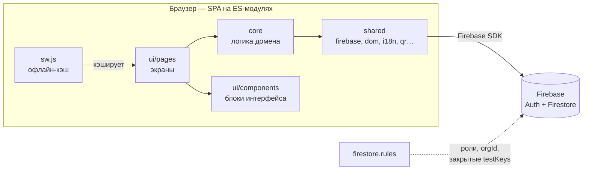

<div align="center">


# Skillbase

**Платформа обучения и проверки знаний для колледжей и университетов:**
дисциплины и темы, электронные материалы-книги, тесты, Live-комнаты и электронный журнал.


</div>

---

## Оглавление

- [О проекте](#о-проекте)
- [Возможности](#возможности)
- [Роли](#роли)
- [Технологии](#технологии)
- [Архитектура](#архитектура)
- [Структура проекта](#структура-проекта)
- [Быстрый старт](#быстрый-старт)
- [Настройка Firebase](#настройка-firebase)
- [Тесты](#тесты)
- [Безопасность](#безопасность)
- [Статус разработки](#статус-разработки)
- [Планы](#планы)
- [Контакты](#контакты)
- [Документация](#документация)
- [Лицензия](#лицензия)

## О проекте

Skillbase — учебный проект: система, в которой преподаватель ведёт дисциплины,
публикует материалы и проверки, а студенты изучают материал и проходят
тестирование. Результаты собираются в электронный журнал и аналитику.

- **Без сборки и фреймворков.** Приложение — статические ES-модули, которые
  GitHub Pages отдаёт как есть. Логика (`core/`), данные (Firebase) и
  интерфейс (`ui/`) разделены.
- **Мобильный приоритет.** Интерфейс проектируется сначала под экран телефона.
- **Два режима.** Education (колледжи и университеты) и Workforce
  (профессиональное обучение сотрудников) — одна платформа, две терминологии
  и оформления. Режим меняет только внешний вид и тексты, права доступа от
  него не зависят (см. [docs/WORKFORCE.md](docs/WORKFORCE.md)).
- **Изоляция организаций.** Данные разделены по `orgId` на уровне правил Firestore.

## Возможности

Реализовано в версии 1.0 (подробности — [docs/STATUS.md](docs/STATUS.md)):

- **Дисциплины и темы** — каталог дисциплин, темы с расписанием, прогресс студента.
- **Электронный материал-книга** — читалка с шрифтом Lora, режимами «бумага»/«ночь»,
  регулировкой шрифта A−/A+ и прогрессом чтения; задания могут требовать
  прочтения материала до теста.
- **Тесты** — конструктор (вопросы, варианты, баллы, перемешивание), импорт
  из текста, публикация, прохождение, результаты, история попыток, удаление с безопасным планом.
- **Live-комнаты** — синхронное тестирование: код и QR для входа, лобби,
  таймеры, рейтинг, подиум, реакции, режимы «дуэль» и «экспресс», табло для проектора,
  журнал фактических участников, история завершённых комнат, экспорт CSV.
- **Электронный журнал** — оценки, посещаемость, сводки по темам и дисциплинам.
- **Аналитика и рейтинги** — результаты по темам, фильтры, таблицы лидеров.
- **Задания** — назначение тестов группам, тренировочные и контрольные виды.
- **Вход** — email и пароль с восстановлением, Google, гостевой доступ по ссылке.
- **Оформление** — светлая и тёмная темы, три скина (Education, Operations, Depot),
  переключатели доступны и гостю, выбор хранится на устройстве.
- **PWA** — Service Worker с версионированным офлайн-кэшем, установка как приложение.
- **Правовые страницы** — политика конфиденциальности, соглашение и правила на
  русском и английском.

## Роли

| Роль | Что доступно |
|---|---|
| **Студент** | Дисциплины и темы, материал-книга, прохождение тестов и заданий, свои результаты, рейтинги |
| **Преподаватель** | Создание и публикация тестов и материалов, назначение заданий, Live-комнаты, электронный журнал, аналитика |
| **Администратор** | Всё преподавателя, а также управление пользователями и ролями организации, админ-панель |

Самостоятельная регистрация всегда создаёт студента; первый администратор
назначается вручную в Firebase Console (см. [docs/FIREBASE_SETUP.md](docs/FIREBASE_SETUP.md)).

## Технологии

| Слой | Решение |
|---|---|
| Интерфейс | Vanilla JavaScript (ES-модули), без фреймворков и сборки |
| Логика | Чистые модули `core/`, тестируемые вне браузера |
| Аутентификация | Firebase Auth (email/password, Google, анонимный доступ) |
| Данные | Firestore + правила безопасности `firestore.rules` |
| Хостинг | GitHub Pages из ветки `master` |
| Офлайн | Service Worker (`sw.js`) + Web App Manifest |
| Тесты | Node.js встроенный test runner (`node --test`), тесты правил через Firebase Rules API |
| QR | Собственный генератор (`shared/qrcode.js`), без внешних библиотек |

## Архитектура



- `shared/main.js` — точка входа; хеш-маршрутизация (`shared/app.js`), страницы
  загружаются динамическим импортом.
- `core/` не зависит от DOM — вся логика домена покрыта unit-тестами.
- Тяжёлые стили Live-комнат догружаются точечно (`shared/load-css.js`), первая
  отрисовка не блокируется.
- Каждый запрос к Firestore проверяется правилами: роли, изоляция организаций,
  запрет чтения правильных ответов студентами.

## Структура проекта

| Путь | Назначение |
|---|---|
| `core/` | Логика домена: авторизация, редактор, прохождение тестов, Live-комнаты (`rooms.js`, `live-auto.js`, `duel-logic.js`), журнал (`journal.js`, `pair-grade.js`), материалы, аналитика, шедулинг |
| `core/import/` | Парсер тестов из текста |
| `shared/` | Инфраструктура: маршрутизация (`app.js`), точка входа (`main.js`), инициализация Firebase, DOM-хелперы, i18n, QR, темы, CSV |
| `ui/pages/` | Экраны приложения (хеш-маршруты) |
| `ui/components/` | Повторяемые блоки: модальные окна, тосты, лидерборд, подиум, QR, переключатели темы и режима |
| `ui/css/` | Стили: токены, база, компоненты, Live, печатная версия, темы скинов |
| `ui/brand/` | Логотип, фавикон, иконки PWA, OG-изображение, манифест |
| `configs/` | Конфигурация: шаблон `firebase.example.js`, идентификаторы организации |
| `tests/` | Unit-тесты логики (`node --test`) |
| `tests/rules/` | Кейсы тестов правил Firestore |
| `tools/` | `rules-test.mjs` (тесты правил), `check.cjs` (целостность), миграции |
| `scripts/` | `bump-version.mjs` (версия кэша перед публикацией), `check-imports.mjs`, `check-contrast.mjs` |
| `docs/` | Документация проекта |
| `index.html` | Точка входа SPA |
| `firestore.rules` | Правила безопасности Firestore |
| `firestore.indexes.json` | Индексы Firestore |

## Быстрый старт

Требования: Node.js 18+ (для тестов), любой статический файловый сервер,
проект Firebase.

```bash
git clone https://github.com/NewRail-project/skillbase.git
cd skillbase

# конфигурация Firebase: скопировать шаблон и вписать ключи своего проекта
cp configs/firebase.example.js configs/firebase.js

# запустить статический сервер (ES-модули не работают с file://)
python3 -m http.server 8080
# или: npx serve .

# открыть http://localhost:8080
```

Самому приложению зависимости не нужны — `npm install` требуется только для
запуска тестов. Добавьте `localhost` в Firebase Console → Authentication →
Settings → Authorized domains, иначе вход не сработает.

Публикация — `git push` в `master` (GitHub Pages подхватывает ветку
автоматически) после `node scripts/bump-version.mjs`, который обновляет
версию офлайн-кэша.

## Настройка Firebase

Полная пошаговая инструкция — [docs/FIREBASE_SETUP.md](docs/FIREBASE_SETUP.md).
Коротко:

1. Создать проект в Firebase Console.
2. Включить Authentication (Email/Password, при необходимости Google).
3. Создать базу Firestore и загрузить `firestore.rules` и `firestore.indexes.json`.
4. Заполнить `configs/firebase.js` (шаблон — `configs/firebase.example.js`;
   не коммитьте свои ключи в публичные форки).
5. Назначить первого администратора вручную в документе `users/{uid}`
   (регистрация всегда создаёт студента).
6. Идентификаторы организации и группы по умолчанию — `configs/organization.js`;
   при их смене обновите и `firestore.rules`, это продублировано в правилах.

Деплой правил (только если менялись правила или индексы):

```bash
firebase deploy --only firestore:rules,firestore:indexes
```

## Тесты

```bash
npm test                    # все unit-тесты логики (node --test)
node --test tests/parser.test.js   # один файл

npm run test:rules          # тесты firestore.rules (нужен вход firebase login)

node scripts/check-imports.mjs   # граф импортов и экспортов
node tools/check.cjs             # целостность проекта
```

Тесты правил можно запустить в окружении эмулятора:

```bash
firebase emulators:exec --only firestore "node tools/rules-test.mjs"
```

## Безопасность

- **Правильные ответы не лежат в публичных данных теста.** Документ `tests/{id}`,
  который читает студент, не содержит вариантов «correct»; ключи и баллы хранятся
  в отдельном закрытом документе `testKeys/{id}`, недоступном студентам по правилам.
- **Изоляция организаций.** Все основные коллекции ограничены `orgId`
  на уровне правил Firestore.
- **Материалы закрыты на время попытки.** При старте теста создаётся маркер
  `activeAttempts/{uid}`, и правила не отдают студенту материалы, пока попытка
  не завершена или срок не истёк (см. [docs/PROGRESS.md](docs/PROGRESS.md)).
- **Честное ограничение:** в Live-комнатах защита от подглядывания в материал —
  только клиентская; полная защита требует серверных проверок и не входит в MVP.
- **Публичный конфиг Firebase — это нормально** для веб-SDK: `apiKey` не секрет,
  доступ к данным ограничивают правила, а не секретность конфига. Сервисных
  ключей и секретов в репозитории нет; не публикуйте их в своих форках.
- Правила Firestore не ослабляются; изменения проверяются `npm run test:rules`.

## Статус разработки

**Версия 1.0 — завершена** ([docs/STATUS.md](docs/STATUS.md)). Личный учебный
проект, рассчитанный на группу и небольшую организацию, а не на массовую нагрузку.

Известные ограничения (приняты осознанно):

- защита от подглядывания материала в Live — только на стороне клиента;
- гость не может читать учебные материалы (правила требуют профиль);
- масштабирование на тысячи одновременных участников Live не проверялось.

## Планы

Направления, следующие из документированных ограничений (сроки не обещаются):

- серверная проверка доступа к материалу во время Live-вопроса;
- пересмотр гостевого доступа к учебным материалам;
- проверка и усиление масштабируемости Live-комнат;
- выбор лицензии проекта.

## Контакты

Контакты совпадают с общедоступной [страницей контактов приложения](https://newrail-project.github.io/skillbase/#contact):

- Telegram: [@Frozencode_f](https://t.me/Frozencode_f), [@YourAssistantWeb](https://t.me/YourAssistantWeb)
- Email: bujlenkovdaniil@gmail.com
- Демо: [newrail-project.github.io/skillbase](https://newrail-project.github.io/skillbase/)

## Документация

| Документ | О чём |
|---|---|
| [docs/DEVELOPMENT.md](docs/DEVELOPMENT.md) | Руководство разработчика: стек, модули, правила разработки |
| [docs/FIREBASE_SETUP.md](docs/FIREBASE_SETUP.md) | Настройка Firebase и первый администратор |
| [docs/STATUS.md](docs/STATUS.md) | Текущий статус и известные ограничения |
| [docs/PROGRESS.md](docs/PROGRESS.md) | Журнал решений: защита от подсказок, Live-этапы, журнал, CSV |
| [docs/LIVE.md](docs/LIVE.md) | Устройство Live-комнат |
| [docs/WORKFORCE.md](docs/WORKFORCE.md) | Режимы Education / Workforce |
| [docs/SELF-PACE.md](docs/SELF-PACE.md) | Тестирование в своём темпе и вердикты ведущего |
| [docs/TEST-DELETION.md](docs/TEST-DELETION.md) | Безопасное удаление тестов |

## Лицензия

Лицензия пока не выбрана — вопрос открыт (см. раздел «Планы»). До выбора
действуют авторские права авторов проекта; для использования вне учебных
целей свяжитесь по контактам выше.

Участие в разработке — [CONTRIBUTING.md](.github/CONTRIBUTING.md);
сообщения об уязвимостях — [SECURITY.md](.github/SECURITY.md).
